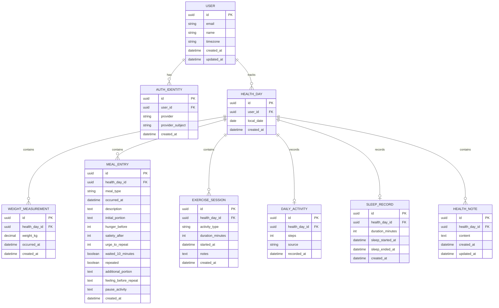

# Arquitectura de Base de Datos — Control Personal de Salud

## 1. Objetivo

Este documento define una propuesta inicial de modelo relacional para la aplicación **Control Personal de Salud**, cuyo frontend está desarrollado con Astro y cuyo backend se desarrollará con NestJS en un repositorio independiente.

El modelo se basa en los campos de la hoja de seguimiento, que contempla:

- Peso.
- Desayuno, comida del mediodía, cena y colaciones.
- Porción inicial.
- Hambre antes de comer, saciedad al terminar y antojo de repetir.
- Pausa de 10 minutos, repetición y cantidad adicional.
- Sensaciones al querer repetir y actividad realizada durante la pausa.
- Bebidas con calorías.
- Ejercicio, duración y tipo.
- Sueño.
- Pasos del iPhone.
- Notas personales.
- Indicadores de resumen semanal.

La decisión de diseño central es que la aplicación funcione como un **registro de eventos de salud a lo largo del día**, no como un formulario diario que deba completarse de una sola vez.

> **Principio fundamental:** cada captura se guarda de manera independiente cuando ocurre. El usuario puede registrar su peso por la mañana, el desayuno unas horas después y la comida por la tarde sin tener que editar una única fila diaria.

## 2. Flujo funcional de captura

1. El usuario inicia sesión con Google.
2. La aplicación lo dirige a su dashboard personal.
3. El usuario pulsa el botón flotante `+`.
4. Se abre un selector del tipo de registro:
   - Peso.
   - Comida o colación.
   - Actividad física.
   - Pasos.
   - Sueño.
   - Nota personal.
5. Se muestra el formulario correspondiente al tipo elegido.
6. La fecha y hora se rellenan por defecto con el momento actual, pero pueden editarse.
7. El usuario guarda el registro.
8. El dashboard presenta las capturas del día ordenadas cronológicamente.

El día de seguimiento no se considera completo por haber registrado el peso o la primera comida. Puede contener cero, uno o varios registros de cada tipo.

### Ejemplo de un día

| Hora | Registro | Datos de ejemplo |
|---|---|---|
| 07:00 | Peso | 110 kg |
| 09:00 | Desayuno | Descripción de lo que comió |
| 14:30 | Comida | Alimentos, porción y preguntas de hambre/saciedad |
| 17:00 | Ejercicio | Caminata, 20 minutos |
| 20:00 | Cena o colación | Descripción de lo que comió |
| Al final del día | Pasos | Total del iPhone |
| Al despertar | Sueño | Duración de la noche anterior |

Los valores anteriores son ilustrativos; no representan datos reales del usuario.

## 3. Decisión de modelado: contenedor diario y eventos

Se propone una entidad `HealthDay` que representa el día de seguimiento de un usuario. Esta entidad agrupa los eventos asociados a una fecha local, pero no almacena todos los campos de la hoja de cálculo en una sola fila.

Cada evento mantiene su propia fecha y hora. Esto permite:

- Capturas parciales durante el día.
- Más de una medición de peso en un día.
- Varias comidas y colaciones.
- Varias sesiones de ejercicio.
- Correcciones de la hora del evento.
- Mostrar una cronología diaria.
- Calcular indicadores semanales a partir de datos detallados.

La fecha del contenedor debe interpretarse en la zona horaria del usuario. Los instantes de los eventos deben almacenarse con una política temporal consistente, por ejemplo timestamps normalizados a UTC, conservando o configurando la zona horaria IANA del usuario cuando sea necesario para agrupar por fecha local.

## 4. Entidades propuestas

Se propone comenzar con nueve entidades principales. La base de datos y el ORM concretos quedan pendientes de decisión y no se presuponen en este documento.

### 4.1 `User`

Representa la cuenta propietaria de los datos de seguimiento.

| Campo | Propósito |
|---|---|
| `id` | Identificador interno, preferiblemente UUID |
| `email` | Correo electrónico |
| `name` | Nombre para mostrar |
| `timezone` | Zona horaria IANA del usuario, por ejemplo `America/Mexico_City` |
| `created_at` | Fecha de creación de la cuenta |
| `updated_at` | Fecha de última actualización |

**Relaciones:**
- Un usuario tiene muchos días de seguimiento (`User 1:N HealthDay`).
- Un usuario tiene una o más identidades de autenticación (`User 1:N AuthIdentity`).

Consideraciones:
- El correo no debe usarse como identificador interno.
- Definir si el correo debe ser único según las reglas de autenticación.
- Los endpoints deben obtener el usuario desde la identidad autenticada; no deben confiar en un `user_id` arbitrario enviado por el cliente.

### 4.2 `AuthIdentity`

Vincula la cuenta interna con un proveedor de identidad, inicialmente Google. Separar esta información permite admitir otros proveedores en el futuro sin rediseñar el perfil.

| Campo | Propósito |
|---|---|
| `id` | Identificador interno |
| `user_id` | FK a `User.id` |
| `provider` | Proveedor de identidad; inicialmente `google` |
| `provider_subject` | Identificador estable que el proveedor asigna a la cuenta |
| `created_at` | Fecha de vinculación |

Restricción recomendada:
- `UNIQUE(provider, provider_subject)`.

Seguridad:
- El backend debe validar el token o flujo de autenticación utilizado.
- No almacenar la contraseña de Google.
- Guardar solo los datos de identidad necesarios para autenticar y vincular la cuenta.

### 4.3 `HealthDay`

Representa el día local de seguimiento de un usuario y funciona como agrupador de registros. No es un formulario diario que tenga que completarse.

| Campo | Propósito |
|---|---|
| `id` | Identificador del día |
| `user_id` | FK a `User.id` |
| `local_date` | Fecha del día según la zona horaria del usuario |
| `created_at` | Fecha de creación del contenedor |

Restricción recomendada:
- `UNIQUE(user_id, local_date)`.

Comportamiento:
- Cuando el cliente consulta un día, el backend puede obtenerlo o crearlo según la estrategia elegida.
- El contenedor puede existir sin mediciones ni eventos.
- Los registros del día deben poder consultarse y ordenarse por su hora de ocurrencia.
- Debe definirse cómo tratar una captura histórica o una captura cuya hora se corrija y termine en otra fecha local.

### 4.4 `WeightMeasurement`

Representa una medición de peso independiente.

| Campo | Propósito |
|---|---|
| `id` | Identificador |
| `health_day_id` | FK a `HealthDay.id` |
| `weight_kg` | Peso en kilogramos |
| `occurred_at` | Fecha y hora a las que corresponde la medición |
| `created_at` | Fecha y hora en que se guardó el registro |

Consideraciones:
- Validar que `weight_kg` sea numérico y esté dentro de límites plausibles definidos por el dominio.
- No imponer una sola medición por día, porque pueden existir varias.
- La medición puede editarse o eliminarse según las reglas de producto y auditoría que se definan.
- Para la tendencia semanal, establecer una regla explícita sobre qué mediciones se incluyen.

### 4.5 `MealEntry`

Representa una ocasión de comida, bebida con calorías o colación. Cada ocasión tiene su propio registro.

| Campo | Propósito |
|---|---|
| `id` | Identificador |
| `health_day_id` | FK a `HealthDay.id` |
| `meal_type` | Tipo: desayuno, comida, cena, colación u otro |
| `occurred_at` | Fecha y hora en que ocurrió la comida |
| `description` | Descripción libre de alimentos y bebidas |
| `initial_portion` | Porción inicial aproximada, por ejemplo cucharones, tortillas o piezas |
| `hunger_before` | Hambre antes de comer, escala 0–10 |
| `satiety_after` | Saciedad al terminar, escala 0–10 |
| `urge_to_repeat` | Antojo de repetir, escala 0–10 |
| `waited_10_minutes` | Indica si se esperaron 10 minutos antes de decidir |
| `repeated` | Indica si se repitió |
| `additional_portion` | Cantidad adicional aproximada |
| `feeling_before_repeat` | Qué sentía el usuario al querer repetir |
| `pause_activity` | Qué hizo durante la pausa |
| `created_at` | Fecha y hora de creación |

Consideraciones:
- Los campos de hambre, saciedad, antojo, pausa y repetición deben ser opcionales, porque no aplican a todas las comidas.
- El formulario puede mostrar estas preguntas principalmente para la comida del mediodía, sin impedir que se registren en otra ocasión.
- Validar las escalas de 0 a 10.
- `description` y `initial_portion` pueden ser texto libre en la primera versión; no se necesita construir inicialmente un catálogo de alimentos.
- Definir si las bebidas con calorías se registran dentro de la descripción de la comida o como una entrada de tipo específico. Para la primera versión, la descripción puede incluirlas.

### 4.6 `ExerciseSession`

Representa una sesión individual de actividad física. Permite registrar varias sesiones en un mismo día.

| Campo | Propósito |
|---|---|
| `id` | Identificador |
| `health_day_id` | FK a `HealthDay.id` |
| `activity_type` | Tipo de actividad, por ejemplo caminata, pesas o bicicleta |
| `duration_minutes` | Duración en minutos |
| `started_at` | Hora de inicio, opcional |
| `notes` | Observaciones opcionales |
| `created_at` | Fecha y hora de creación |

Consideraciones:
- La duración debe ser un número no negativo y validarse según límites razonables del dominio.
- Si no se conoce la hora de inicio, se puede guardar la duración y el tipo sin inventar una hora.
- El resumen diario puede sumar las duraciones de todas las sesiones.
- Si en el futuro se necesita registrar actividad continua o importar entrenamientos, el modelo puede ampliarse.

### 4.7 `DailyActivity`

Representa los pasos acumulados de un día, normalmente copiados o sincronizados desde Apple Salud/iPhone.

| Campo | Propósito |
|---|---|
| `id` | Identificador |
| `health_day_id` | FK a `HealthDay.id` |
| `steps` | Total de pasos |
| `source` | Origen, por ejemplo `manual` o `iphone_health` |
| `recorded_at` | Fecha y hora en que se registró o sincronizó el total |

Restricción inicial recomendada:
- `UNIQUE(health_day_id)`, si se mantiene un solo total diario por día.

Consideraciones:
- Los pasos no equivalen a una sesión de ejercicio y deben modelarse por separado.
- Si más adelante se importan varias lecturas o sincronizaciones durante el día, habrá que definir si se actualiza el total diario o se crea una entidad de sincronización/historial.
- No sumar capturas de totales acumulados como si fueran incrementos; eso duplicaría los pasos.

### 4.8 `SleepRecord`

Representa el sueño asociado al día en que el usuario despertó, según la regla de negocio propuesta.

| Campo | Propósito |
|---|---|
| `id` | Identificador |
| `health_day_id` | FK a `HealthDay.id` |
| `duration_minutes` | Duración del sueño en minutos |
| `sleep_started_at` | Inicio del sueño, opcional |
| `sleep_ended_at` | Fin del sueño, opcional |
| `created_at` | Fecha y hora de creación |

Restricción inicial recomendada:
- `UNIQUE(health_day_id)`, si se registra un único resumen de sueño por día.

Regla de negocio recomendada:
- Atribuir el sueño nocturno al día en que el usuario despertó.
- Si solo se conoce la duración, permitir registrar las horas sin exigir inicio y fin.
- Definir cómo se tratarán siestas o múltiples periodos de sueño antes de incorporarlos.

### 4.9 `HealthNote`

Permite guardar observaciones generales del día que no necesariamente pertenecen a una comida o sesión de ejercicio.

| Campo | Propósito |
|---|---|
| `id` | Identificador |
| `health_day_id` | FK a `HealthDay.id` |
| `content` | Nota breve |
| `created_at` | Fecha y hora de creación |
| `updated_at` | Fecha y hora de última actualización |

Relación:
- Un día puede tener cero o muchas notas (`HealthDay 1:N HealthNote`).

## 5. Relaciones y cardinalidades

| Relación | Cardinalidad | Motivo |
|---|---|---|
| `User → AuthIdentity` | 1:N | Un usuario puede vincular identidades de acceso |
| `User → HealthDay` | 1:N | Un usuario tiene muchos días de seguimiento |
| `HealthDay → WeightMeasurement` | 1:N | Puede haber varias mediciones en un día |
| `HealthDay → MealEntry` | 1:N | Puede haber varias comidas y colaciones |
| `HealthDay → ExerciseSession` | 1:N | Puede haber varias sesiones de ejercicio |
| `HealthDay → DailyActivity` | 1:0..1 inicialmente | Puede faltar el total de pasos |
| `HealthDay → SleepRecord` | 1:0..1 inicialmente | Puede faltar el registro de sueño |
| `HealthDay → HealthNote` | 1:N | Puede haber varias notas en un día |

### Diagrama ER conceptual



El diagrama es conceptual. Los tipos SQL exactos y la sintaxis de claves foráneas deben adaptarse a la base de datos que se elija.

## 6. Entidades futuras opcionales

### `Food` y `MealItem`

No son necesarias para la primera versión si la descripción de alimentos se guarda como texto libre. Se pueden agregar si después se requieren consultas por ingrediente, cantidades estructuradas o estimaciones nutricionales.

- `Food`: catálogo de alimentos.
- `MealItem`: elemento consumido en una comida, con alimento, cantidad y unidad.

Relaciones futuras:
- `MealEntry 1:N MealItem`.
- `Food 1:N MealItem`.

Esta alternativa mejora el análisis, pero aumenta la complejidad de captura y mantenimiento. No conviene construir el catálogo antes de que exista una necesidad concreta.

### `WeeklySummary`

No se recomienda persistir una tabla de resumen semanal en la primera versión. Los indicadores pueden calcularse mediante consultas sobre los registros fuente. Solo convendría guardar resultados agregados si posteriormente existe una necesidad de rendimiento, auditoría o snapshots históricos.

## 7. Cálculo de los indicadores semanales

Los datos de la hoja se pueden obtener de las entidades propuestas.

| Indicador | Fuente y cálculo propuesto |
|---|---|
| Peso promedio | Promedio de `WeightMeasurement.weight_kg` en el periodo, aplicando una regla definida para mediciones múltiples |
| Cambio respecto a la semana anterior | Promedio de la semana actual menos promedio de la semana anterior |
| Días con comida registrada | Conteo de fechas distintas con al menos un `MealEntry` |
| Días que hicieron la pausa | Conteo de días distintos con un registro de comida marcado con `waited_10_minutes = true` |
| Días que repitieron | Conteo de días distintos con un registro marcado con `repeated = true` |
| Qué aprendí esta semana | Texto ingresado por el usuario o una futura entidad de reflexión semanal; no se deriva automáticamente con fiabilidad |
| Promedio de ejercicio | Suma de minutos de `ExerciseSession` dividida entre el número de días establecido por el indicador |
| Promedio de pasos | Promedio de los totales de `DailyActivity` del periodo, definiendo cómo tratar los días sin registro |

Reglas que deben definirse antes de implementar los reportes:
- Si el promedio de ejercicio se calcula sobre siete días o solo sobre días con actividad registrada.
- Si los días sin pasos registrados se excluyen o cuentan como faltantes; no deben tratarse automáticamente como cero.
- Cómo elegir mediciones de peso cuando hay varias en un día.
- Si los conteos de pausa y repetición se refieren a días o a ocasiones de comida.
- Qué días componen cada semana y en qué zona horaria se calculan.

## 8. API REST inicial sugerida

Los siguientes endpoints son una propuesta de interfaz, no contratos implementados.

```text
POST /api/weight-measurements
POST /api/meals
POST /api/exercise-sessions
POST /api/daily-activity
POST /api/sleep-records
POST /api/health-notes

GET  /api/health-days/:localDate
GET  /api/health-days/:localDate/summary
```

El endpoint `GET /api/health-days/:localDate` devolvería el día y sus registros asociados, agrupados y ordenados cronológicamente. El backend debe aplicar siempre el alcance del usuario autenticado.

Consideraciones de API:
- Cada tipo de registro tiene su propio DTO de entrada y validación.
- La hora del evento puede ser editable; el valor inicial en la interfaz es la hora actual.
- El backend obtiene el usuario desde la sesión/token autenticado, no de un identificador arbitrario enviado por el cliente.
- Validar escalas, cantidades, fechas y tipos en runtime.
- Mantener errores de validación consistentes.
- Definir política de actualización y eliminación de registros.
- Configurar CORS, secretos y URLs mediante variables de entorno.
- No registrar datos de salud sensibles en logs innecesariamente.

## 9. Consideraciones de seguridad y privacidad

La aplicación contiene información personal relacionada con la salud. Se recomienda:

- Autenticar todas las rutas privadas.
- Autorizar cada lectura, actualización y eliminación para que el usuario solo acceda a sus datos.
- Validar tokens de identidad en el backend y no confiar solo en datos enviados por el frontend.
- No almacenar contraseñas de Google.
- Usar HTTPS en despliegues.
- Mantener secretos fuera del repositorio.
- Validar y limitar el tamaño de entradas de texto.
- Evitar exponer datos de salud en logs, errores o métricas.
- Definir reglas de respaldo, retención y eliminación de datos antes de producción.

## 10. Decisiones pendientes

No se deben inventar ni asumir las siguientes decisiones antes de acordarlas:

1. **Base de datos:** PostgreSQL, MySQL u otra.
2. **ORM o acceso a datos:** por ejemplo, Prisma, TypeORM u otra estrategia.
3. **Autenticación:** flujo exacto de Google, gestión de sesión, JWT o cookies seguras.
4. **Zona horaria:** si se configura por usuario y cómo se actualiza.
5. **Edición y borrado:** comportamiento, confirmaciones y posible auditoría.
6. **Datos de alimentos:** texto libre inicialmente o catálogo estructurado en una fase posterior.
7. **Sincronización de Apple Salud:** captura manual inicial o integración futura.
8. **Definición de los reportes:** reglas precisas para promedios, semanas y datos faltantes.

## 11. Criterios de implementación

- Mantener el backend organizado por módulos de dominio en NestJS.
- Evitar una tabla por día de la semana o una tabla con todos los campos de la hoja.
- Evitar que la captura de un evento requiera enviar el resto de los campos del día.
- Aplicar validación de entrada en el backend.
- Usar claves foráneas y restricciones únicas para reforzar la integridad.
- Crear índices en las claves foráneas y en las consultas frecuentes, especialmente por usuario y fecha.
- No introducir `WeeklySummary`, catálogo de alimentos, CQRS, Event Sourcing ni capas de abstracción genéricas sin una necesidad demostrable.
- Probar la creación, consulta, actualización y eliminación de registros, así como los permisos entre usuarios.
- Mantener la documentación alineada con las migraciones y los DTO implementados.

## 12. Recomendación

Para la primera versión, implementar `User`, `AuthIdentity`, `HealthDay`, `WeightMeasurement`, `MealEntry`, `ExerciseSession`, `DailyActivity`, `SleepRecord` y `HealthNote`.

Este diseño permite registrar eventos parciales durante el día, conserva la hora de cada evento y facilita construir un dashboard cronológico y reportes semanales sin guardar agregados redundantes.

La base de datos y el ORM deben seleccionarse antes de crear las migraciones. La autenticación y la autorización deben implementarse de forma que todos los registros pertenezcan inequívocamente al usuario autenticado.
